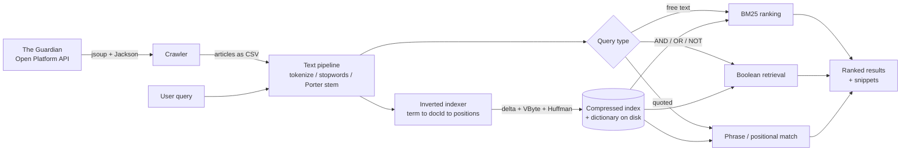

# 🔎 The Crawlers — News Search Engine

> A full-text news search engine built **from scratch in Java** — no Lucene, no Elasticsearch.
> It crawls thousands of Guardian articles, runs them through a real NLP pipeline, builds a
> **compressed positional inverted index**, and answers **ranked, Boolean, and phrase queries**
> in milliseconds.


-1BA94C)


---

## Overview

This project implements a complete information-retrieval system — **crawling, indexing, and
ranked retrieval** — with every stage written by hand rather than delegated to a search library.
It was built by *Team 5 "The Crawlers"* for the **Design and Implementation of Search Engines**
course (Summer Semester 2019) and indexes articles from
[The Guardian's Open Platform API](https://open-platform.theguardian.com/).

| Metric | Value |
| --- | --- |
| 📰 Articles crawled & indexed | **~2,800** |
| 🔤 Query types | ranked free-text · Boolean · phrase |
| 🏆 Ranking model | **Okapi BM25** |
| 🗜️ Index storage | **compressed** — Δ-encoding + Variable-Byte + Huffman |
| 🧱 External search libraries | **none** — index & ranking built from scratch |

## Features

- **BM25 ranking** — results are scored with the Okapi **BM25** model (tunable `k1`, `b`, `k2`),
  the same family of ranking functions used by Lucene and Elasticsearch.
- **Boolean retrieval** — `AND` / `OR` / `NOT` with parentheses and operator precedence, evaluated
  with an operator/operand stack (e.g. `Merkel NOT Trump`, `(Trump AND Putin) OR G20`).
- **Phrase queries** — quoted queries like `"make America great again"` are matched using the
  **positional** postings, so word order matters.
- **Positional inverted index** — stores `term → { docId → [positions] }`, the foundation for
  phrase and proximity search.
- **Compressed on-disk index** — postings are gap-encoded (Δ) then **Variable-Byte** encoded, and
  the term dictionary is **Huffman**-coded, so the index stays compact and fast to load.
- **Real NLP normalization** — tokenization, lower-casing, stop-word removal and **Porter
  stemming** (Apache OpenNLP), applied identically to documents and queries so `running`, `runs`
  and `ran` all match.
- **Keyword-in-context snippets** — results show the matched terms within their surrounding text.

## Index & compression design

The index is split into a **dictionary file** and a **postings file**, each compressed with the
method best suited to it — Huffman for the token strings, Variable-Byte for the numeric byte
offsets and gap-encoded posting lists. This keeps decompression fast and parallelizable.


## Search in action

Ranked results for the phrase query `"fridays for future"` — each hit shows the title, authors,
source URL, and keyword-in-context snippets:


## Architecture



## Tech stack

| Concern | Technology |
| --- | --- |
| Language | Java 8+ |
| HTTP / HTML parsing | [jsoup](https://jsoup.org/) |
| JSON parsing | [Jackson](https://github.com/FasterXML/jackson) |
| NLP / stemming | [Apache OpenNLP](https://opennlp.apache.org/) (Porter stemmer) |
| Ranking | Okapi BM25 (implemented from scratch) |
| Compression | Δ-encoding · Variable-Byte · Huffman coding (from scratch) |
| Tests | JUnit 5 |

## Getting started

### Prerequisites

- **JDK 8+** (the crawler uses `javafx.util.Pair`, bundled with JDK 8)
- A free **Guardian Open Platform** API key — only needed to crawl fresh data. Searching the
  bundled offline corpus works without one.

### Configuration

No API key is committed to this repository. To crawl fresh articles, supply your own key via the
`GUARDIAN_API_KEY` environment variable:

```bash
# Linux / macOS
export GUARDIAN_API_KEY="your-key-here"

# Windows (PowerShell)
$env:GUARDIAN_API_KEY = "your-key-here"
```

The code reads it at runtime with `System.getenv("GUARDIAN_API_KEY")` (see `Constants.java`).

### Run

The repository is an **Eclipse/IntelliJ** project:

1. **Import** it into your IDE and make sure the jars in `libs/` are on the build path
   (referenced by `.classpath`).
2. Run **`Main`** (`de.intsys.krestel.SearchEngine.Main`). By default it loads the index and runs
   a batch of sample queries, then drops into an interactive prompt.
3. Type a query and press Enter. Try:
   - `Trump Putin` — ranked free-text search
   - `Merkel NOT Trump` — Boolean
   - `"fridays for future"` — phrase search
4. Type `exit` to quit.

Prebuilt runnable jars are also included in the repo root (`SearchEngine.jar`).

## Project structure

```
src/de/intsys/krestel/SearchEngine/
├── Main.java                     # Entry point: load index, run queries
├── SearchEngineTheCrawlers.java  # Crawls The Guardian API; orchestrates index/search
├── Article.java / LightArticle.java   # Article model + text normalization
├── InvertedIndexer.java          # Builds & queries the positional inverted index
├── IdxDico.java                  # Index dictionary (term → byte offset)
├── BooleanRetrieval.java         # AND / OR / NOT query evaluation
├── search/BM25.java              # Okapi BM25 ranking
├── hdt/VByte.java, Mutable.java  # Variable-Byte integer (de)compression
├── kimhuffman/                   # Huffman coding for the term dictionary
├── Constants.java                # Configuration (API key read from env)
└── ArticleTest.java              # JUnit tests
libs/                             # Bundled dependencies (jsoup, Jackson, OpenNLP)
img/ · Assignments/               # Screenshots, report figures, course assignments
```

## Team

Built by **Team 5 — The Crawlers**:

- **Mohamed Karim Belaid** ([@Karim-53](https://github.com/Karim-53))
- **Faizuddin Nasaruddin**

<sub>Course project for Data-Intensive Systems Engineering (DISE), Summer Semester 2019. A
developer API key that appeared in earlier commits has since been revoked.</sub>
